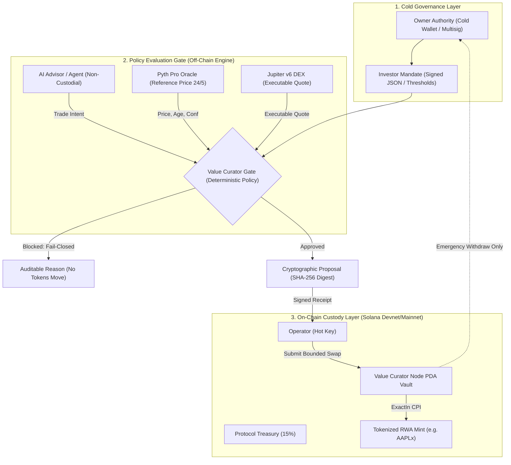

# 🏛️ Value Curator — Architecture & Security Model

> **Vision:** Evidence-gated execution infrastructure for autonomous finance and tokenized real-world assets on Solana.

Value Curator decouples *autonomous decision-making* from *capital custody*. An AI agent or algorithmic operator may analyze the market and propose rebalancing trades, but it can never hold private keys, alter custody rules, or bypass the investor's constitutional mandate.

---

## 📐 1. System Pipeline Overview



---

## 🛡️ 2. Separation of Authorities

Value Curator enforces strict authority separation directly at the Solana smart contract level:

| Role | Key Type | Responsibilities | Security Guarantee |
| :--- | :--- | :--- | :--- |
| **Owner** | Cold Key / Multisig | Initializes the node, rotates operators, emergency fund withdrawal. | Governs the PDA; cannot be impersonated by the operator. |
| **Operator** | Hot Key | Triggers yield metabolism (`metabolize_yield`) and executes strategy swaps. | Limited by allowlisted output mints and exact input caps. |
| **Treasury** | Public Address | Destination account for protocol infrastructure funding (15%). | Fixed destination configured at node initialization. |
| **AI Advisor** | No Keys | Recommends actions, provides contextual summaries. | **Zero custody, zero signing authority, zero direct contract calls.** |

---

## 🌐 3. Transparent Hybrid Architecture (Devnet Custody + Mainnet Oracles)

In the current demonstration and starterkit version:
1. **Custody Smart Contract:** Deployed on **Solana Devnet** (`6owAcXj4FxJom96cEX9CSFjGrg6zp4U8atTjrpCUMiW5`).
2. **Market Observation & Liquidity:** Real-time data ingested from **Mainnet-Beta** (Pyth Pro feed `922` and live Jupiter v6 USDC → AAPLx quotes).
3. **Execution Safety Gate:** Operates in `APPROVAL_ONLY` mode. It produces auditable cryptographic receipts signed with Ed25519 without broadcasting unhedged swaps to Mainnet prior to institutional security audits.

```text
[Mainnet Pyth Feed 922]  ──────┐
                               ├──> [Value Curator Gate] ──> [Ed25519 Receipt]
[Mainnet Jupiter v6 Quote] ────┘                                  │
                                                                  ▼
[Devnet Anchor Custody Program] <────── Verified On-Chain Verification
```

---

## 🗄️ 4. Node PDA & Vault Mechanics

The node vault is an off-curve Program Derived Address (PDA) derived using:
```rust
seeds = [b"node", owner.key().as_ref()]
```
* **Metabolize Yield (15/85 Split):** Token inflows are partitioned into:
  * $15\%$ to protocol infrastructure maintenance.
  * $85\%$ locked into the node vault for strategy compounding.
* **Emergency Withdraw:** If an anomaly or operator breach occurs, only the `owner` can call `emergency_withdraw` to sweep all vaulted funds to safety.
