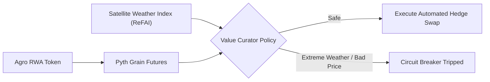
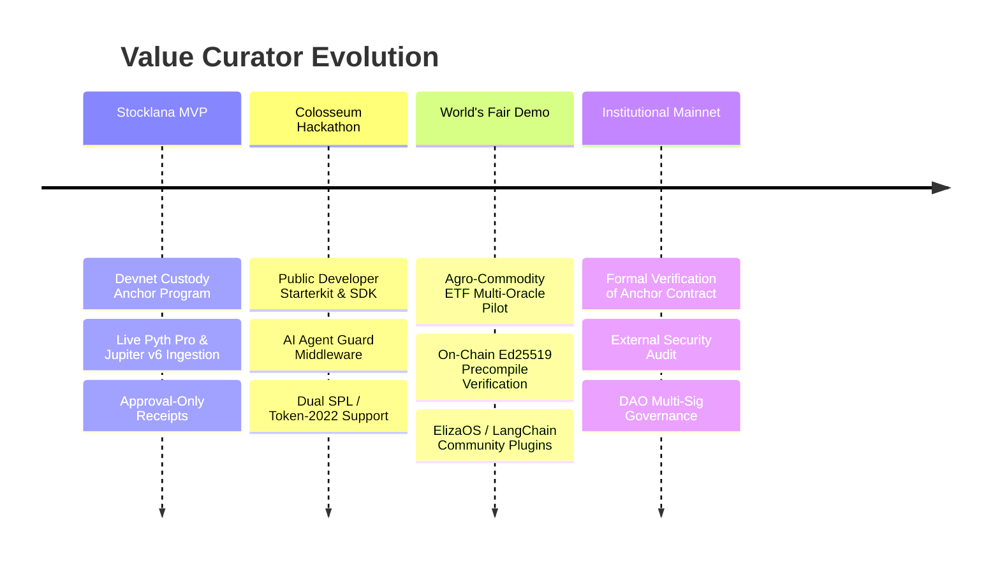

# 🚀 Value Curator — Colosseum World's Fair Roadmap & Expansion Cases

> Expanding from Single-Stock Demonstration (`AAPLx`) to Trillion-Dollar Real-World Asset (RWA) Verticals and Autonomous Community Governance.

While the Stocklana MVP demonstrated deterministic protection on tokenized tech equities, the **Value Curator** architecture is designed to safeguard any asset class where programmatic execution meets market volatility.

---

## 🌾 1. Agricultural Commodity ETFs & Bio-Economy (ReFAI)

### 💡 The Problem
Agricultural commodities (soybeans, corn, cattle, carbon credits) suffer from high climate risks, physical supply constraints, and geopolitical volatility. Autonomous hedge funds and regional treasuries cannot safely deploy automated rebalancing without multi-layered sensory input.

### 🛡️ The Value Curator Solution
Implement a **Bio-Economic Deterministic Mandate**:
1. **Pyth Commodity Reference Feed:** Tracks CME / B3 commodity futures indices with strict deviation and confidence tolerances.
2. **Climate & Satellite Oracles (ReFAI Integration):** Connects to spatial oracles (e.g., weather telemetry, NDVI crop health satellite indices).
3. **Execution Rule:**
   $$\text{Execute Hedge Trade} \iff \text{Oracle Deviation} \le 150\text{ bps} \land \text{Drought/Flood Risk Index} < \text{Critical Threshold}$$



---

## 👥 2. Social Trading & Community-Governed ETFs (DAO Constitution)

### 💡 The Problem
In social trading or DAO-managed portfolios, community members or celebrity lead traders propose portfolio rebalancings. High social momentum frequently leads to panic buying, FOMO-driven trades into illiquid tokens, or meme coin manipulation (Governance Attack).

### 🛡️ The Value Curator Solution: "Constitution in Code"
Value Curator operates as an **Inviolable Community Circuit Breaker**:
* Even if $95\%$ of a DAO votes in favor of a trade, the on-chain/off-chain gate **vetoes the execution** if:
  1. The target asset is not on the DAO's pre-approved constitutional whitelist.
  2. The DEX slippage exceeds 1.5% due to thin liquidity.
  3. The trade size exceeds the 24-hour treasury rebalance quota.

---

## 🤖 3. Universal AI Agent Guard Plugin (`withValueCuratorGuard`)

### 💡 The Problem
Autonomous AI agents powered by LLMs (ElizaOS, Rig, LangChain, Vercel AI SDK) are rapidly gaining wallet signing abilities. However, prompt injection, model hallucinations, or leaked hot keys frequently lead to catastrophic loss of capital.

### 🛡️ The Value Curator Solution
A drop-in middleware wrapper:
```typescript
import { withValueCuratorGuard } from "@value-curator/sdk";

// Wrap any LLM agent action with a constitutional mandate
const safeTrade = withValueCuratorGuard(agentAction, {
  mandate: conservativeDaoMandate,
  provider: pythJupiterProvider,
  extractIntent: (promptResult) => promptResult.tradeIntent,
});

// Guaranteed fail-closed execution
await safeTrade({ asset: "AAPLx", amountUsdc: 50 });
```

---

## 📅 Roadmap to Mainnet


